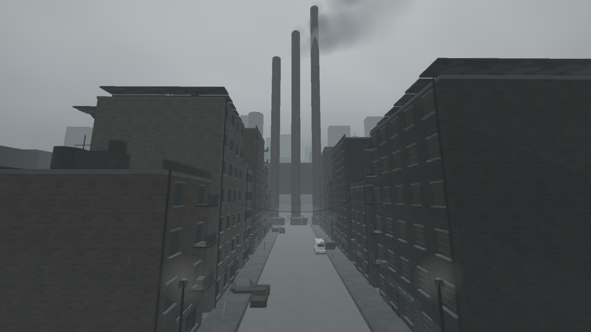
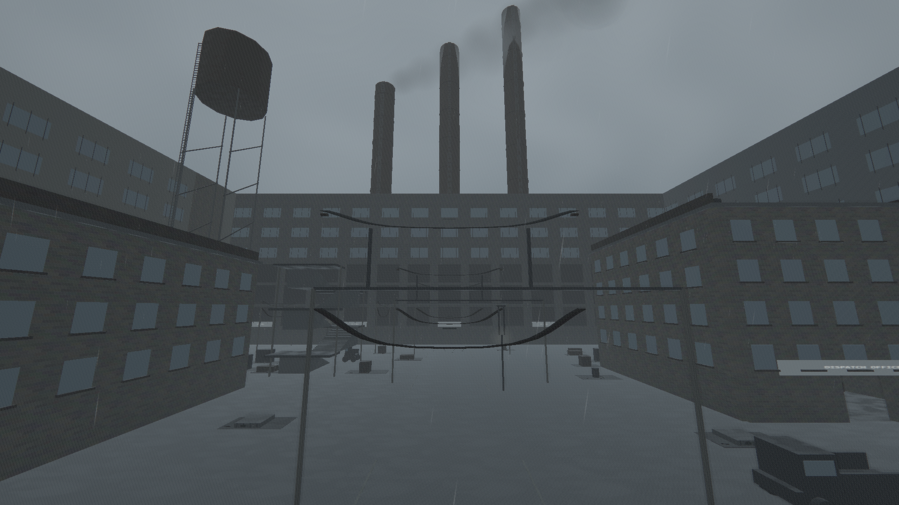
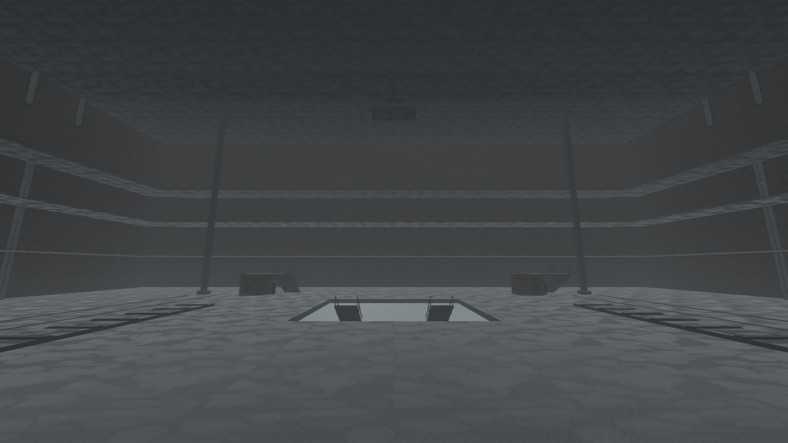
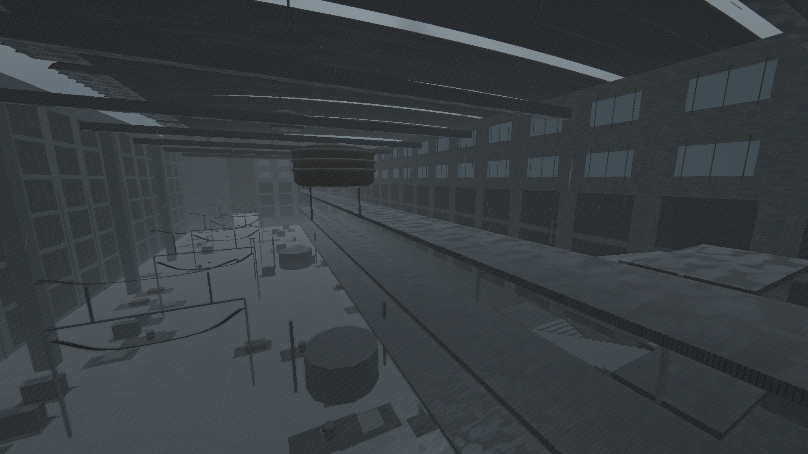
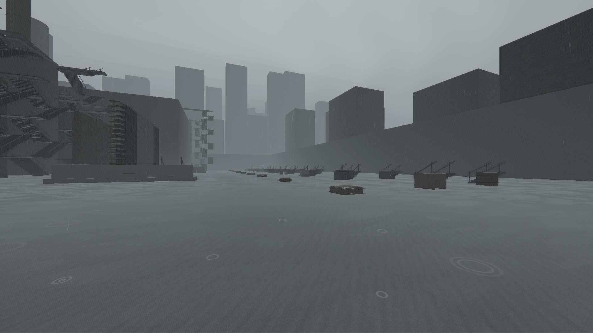
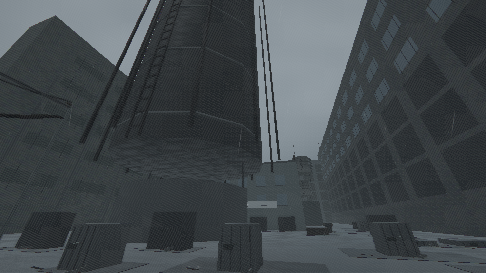
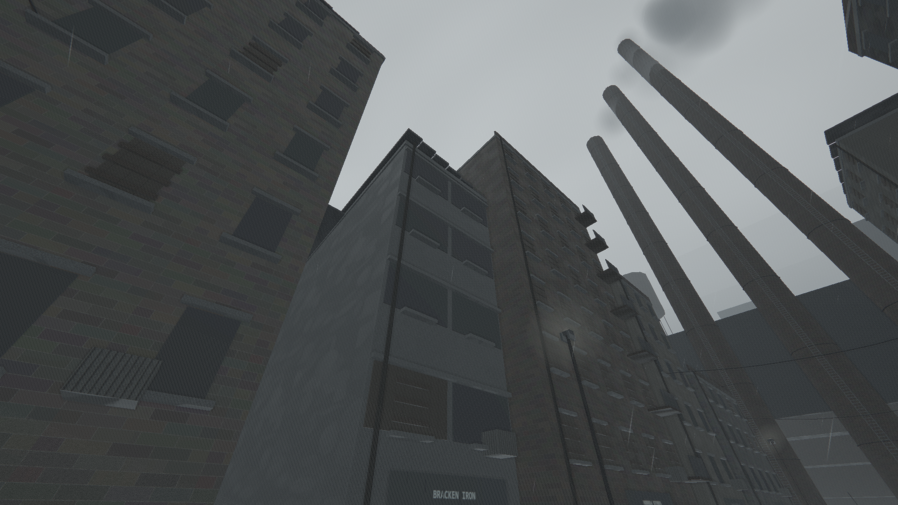
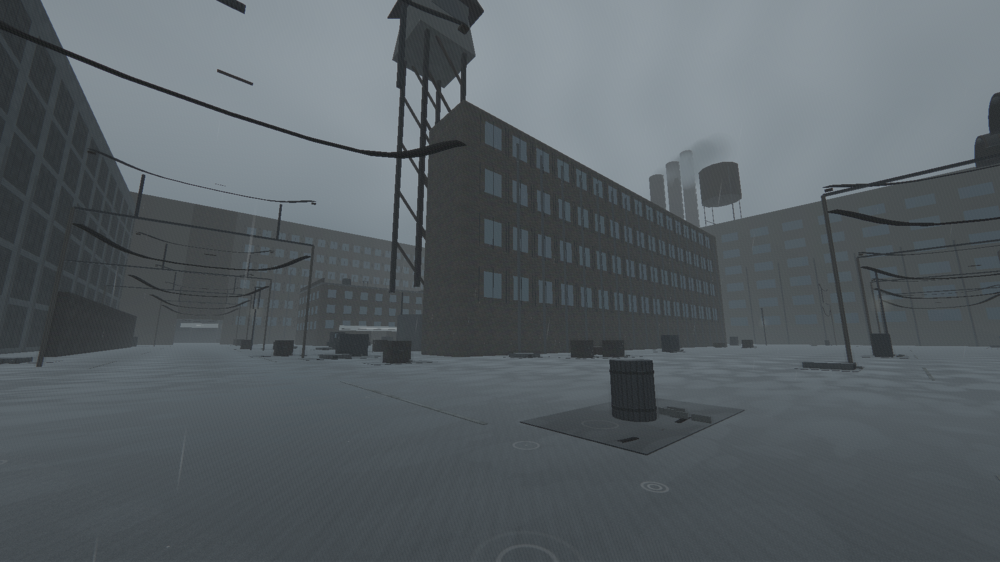
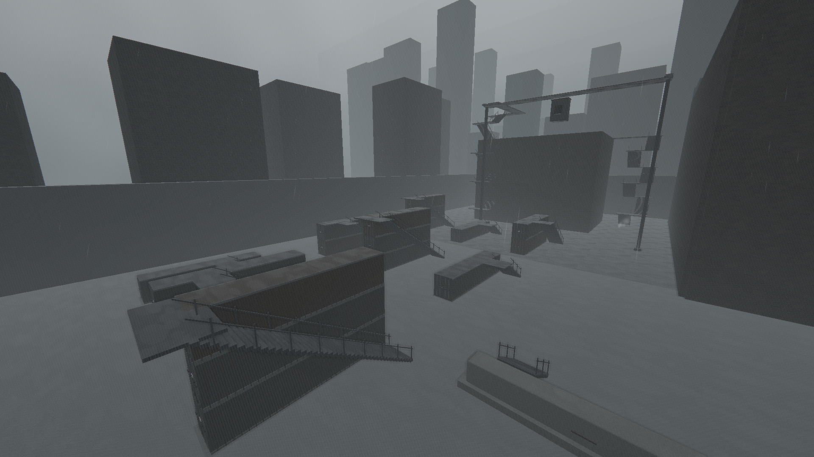
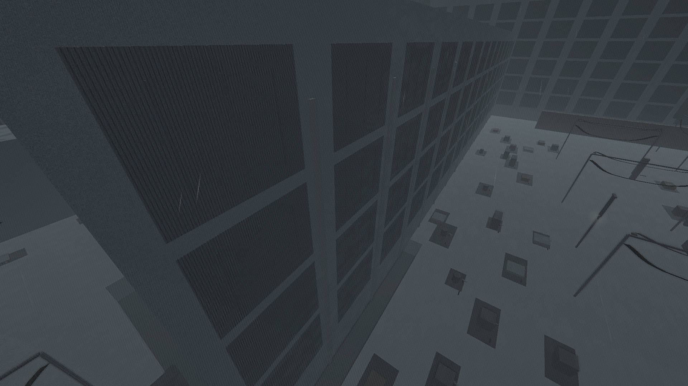

# Visual review — 23 October 2026

The redesign is technically playable but **does not yet satisfy all of the requested visual acceptance criteria**. All 37 final world views and all six gallery views were inspected on the eleven contact sheets. The 15 baseline images and their measurements remain in [CRITIQUE.md](CRITIQUE.md). No image-difference score is presented as a substitute for visual judgment.

| Original complaint                       | Evidence after the rewrite                                                                                                                                                                                                                                                                             | Result                                           |
| ---------------------------------------- | ------------------------------------------------------------------------------------------------------------------------------------------------------------------------------------------------------------------------------------------------------------------------------------------------------ | ------------------------------------------------ |
| Empty                                    | Seven seeded dressing budgets, 168 cover points, 14 composed equipment/vehicle groups, signage and interiors. However, rail-player, hall-player and core-player still have broad repetitive ground spaces; raw trim counts exaggerate perceived density.                                               | Improved, unresolved                             |
| Flat                                     | Real −3 m yards, +4 m rail, 14.4/18 m required roofs, two mezzanines and 6/12/18 m hall galleries; shallow stairs connect levels. See rail-high, hall-high and inside-gate-workshop.                                                                                                                   | Resolved structurally                            |
| Buildings repeat / walk-through geometry | Matching visual/collider authoring replaces client-only reachable facade additions. 3,445,464 mesh rays and 4,824 facade walks pass. Facade rhythm and backing-block silhouettes still repeat despite 28 archetype identifiers.                                                                        | Collision resolved; visual repetition remains    |
| No local landmarks                       | Nine silhouettes, distinct equipment and zone codes; 91 image comparisons and nine actual mesh visibility probes pass. Signal, gantry, gas-holder and furnace long-distance stations require elevated cameras. Some shots show only a small exposed component.                                         | Not fully resolved for player orientation        |
| Boxy                                     | Expanded forge supplies curved pipes, cooling profiles, gas holder, bridge trusses, ladders, arches and irregular rubble. Gallery demonstrates them. Tall rectangular partitions still dominate the playable world.                                                                                    | Improved, unresolved                             |
| Cramped / poor routes                    | 8 m main lanes, 4 m flanks, 4 × 3.6 m doors, 1.3 m optional slide tunnel, loop-connected secondary routes, no clearance audit errors. Long straight views and only straight wall-run lines remain less varied than requested.                                                                          | Clearance resolved; route composition incomplete |
| Reads as blockout                        | Surface wear, equipment and shelf/workbench interiors improve detail. The collision-safe overhead clearance produces visibly separated roof skins/crowns; supports and believable equipment integration need more art work. Hall central pit and fully distinct zone sound beds are also not complete. | Unresolved                                       |
| Twenty-second map crossing               | 420 × 340 m footprint; intended 2,251 m route takes 284.05 seconds in the sprint bot, 140.6875 seconds at constant cap. Sequential gate graph and sampled movement probes pass.                                                                                                                        | Resolved for intended progression                |

## Before and after pairs

The footprint and camera locations changed; these pair corresponding subjects, not pixel-identical camera poses. All individual 1920 × 1080 captures remain available in the linked directories.

| Subject                  | Before                                      | After                                          |
| ------------------------ | ------------------------------------------- | ---------------------------------------------- |
| Arrival composition      |    |         |
| Hall circulation         |              |              |
| Industrial machinery     |      |          |
| District architecture    |          |  |
| Rail and vertical routes |  |              |

[Before map](map-before.svg) · [After map](map-after.svg) · [Layout and timing](LAYOUT.md) · [Performance](../perf/redesign-summary.md)

## Remaining acceptance gaps

The current forge has 89 families / 267 exported variants, but 28 building archetype IDs do not establish 24 convincingly distinct authored building designs. The new districts need more recognizable massing and equipment placement, not additional copies of small debris. Some roof/crown ornaments stand too far above their supporting bases after the conservative clearance correction. Several large tank forms overlap nearby building footprints. The hall lacks the requested central pit. Adjacent material treatments and three ambient emitter types do not yet produce seven unmistakable lighting/sound identities. Sightline length is not exhaustively capped at 110 m, and corner/zigzag wall-run chains are not authored.

These are in-scope shortcomings, recorded as FAIL in criteria 1, 5 and 6; they are not deferred under an unrelated-feature label. No weapons, AI, combat behavior, networking semantics or deployment changes were added.
